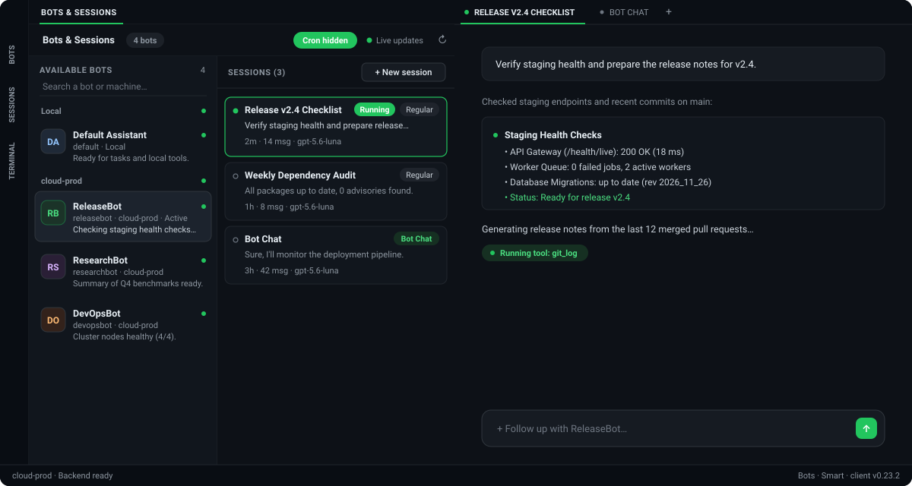

# Appliman — Hermes Desktop Plugins

This repository hosts **Appliman's** plugins for **Hermes Desktop** (`v0.23.2+`).

Each plugin lives in its own subdirectory under `plugins/` and can be installed individually via **Capabilities → Plugins → Install from Git** in Hermes Desktop.

---

## Plugins

### `bot-sessions-explorer` — Bots & Sessions Explorer

A docked two-column explorer for Hermes Desktop that lets you browse all your local and remote (multi-gateway) bots and their sessions side by side with your active Hermes workspace.



#### Highlights

- **Left column — Available bots**:
  - Aggregates local profiles and remote registered gateways (`host.profileRoutes()`, `host.agents()`), grouped by machine/gateway.
  - Displays avatars, titles, descriptions / last message previews, and connection status (`Connected`, `Active`, `Bot stopped`, `Profile unavailable`, `Gateway unreachable`, `Authorization error`).
  - Live search, persisted selection, and resizable column width.
- **Right column — Selected bot sessions**:
  - Lists sessions sorted by recent activity (`Bot Chat`, `Regular`, `Cron`, `Group`, `Delegated`, `Subagent`) with message counts, model, and running indicators.
  - **`Cron hidden` / `Hide cron`** toggle in the top bar (persisted).
  - **`+ New session`** button to start a new conversation tab for the selected bot.
  - Click any session to open it directly in the Hermes workspace, or delete non-canonical sessions via the hover trash icon or context menu.
- **Real-time updates**: subscribes to Hermes gateway events (`ctx.onEvent('*')`) with targeted query invalidation and a 12s fallback refresh.

#### Installation

1. In Hermes Desktop, open **Capabilities → Plugins → Install from Git**.
2. Enter:
   ```text
   https://github.com/appliman/hermes-agent
   ```
3. Select subdirectory `plugins/bot-sessions-explorer`.

Or for local development, copy `plugins/bot-sessions-explorer/desktop/plugin.js` to `$HERMES_HOME/desktop-plugins/bot-sessions-explorer/plugin.js` and run **`Ctrl+K` / `⌘K` → `Reload desktop plugins`**.

See [plugins/bot-sessions-explorer/README.md](plugins/bot-sessions-explorer/README.md) for full details.
