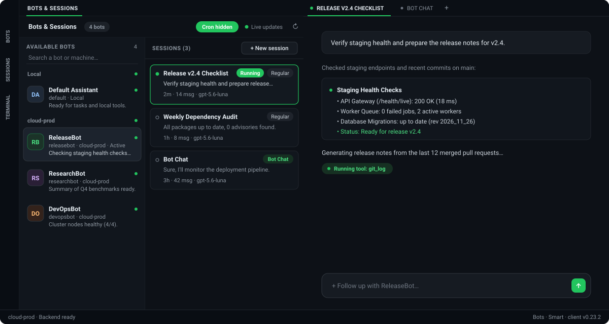

# Bots & Sessions Explorer (`bot-sessions-explorer`)

Desktop plugin for **Hermes v0.23.2+** providing a docked two-column explorer to browse all available bots (local and remote gateways) and their sessions.



## Features

- **Left column — Available bots**:
  - Grouped by machine / gateway (`ConnectionGlyph`)
  - Avatar (`Blobatar` or profile image), title, profile name, description / last message preview
  - Differentiated status: `Connected`, `Active`, `Bot stopped`, `Profile unavailable`, `Gateway unreachable`, `Authorization error`, `Desktop connection interrupted`
  - Live search, persisted selection (`ctx.storage`), double-click to open Bot Chat, context menu
  - Resizable column width (persisted)
- **Right column — Selected bot sessions**:
  - Fetches sessions via `host.listPersistedSessions(...)` with `session.list` and `session.active_list` fallbacks
  - Includes the canonical `Bot Chat` (`bot_chat`) and recent session
  - Session type badges: `Bot Chat`, `Regular`, `Cron`, `Group`, `Delegated`, `Subagent`
  - Sorted by recent activity, with a `Hide cron` / `Cron hidden` toggle in the top bar
  - `+ New session` button to start a new conversation for the selected bot
  - Click a session to open it directly in Hermes (`host.openSession`), delete via hover trash icon or context menu (with confirmation), copy ID, or inspect details
- **Real-time & resilience**:
  - Listens to Hermes events (`ctx.onEvent('*')`) with targeted cache invalidation + 12s fallback polling
  - Light/dark theme compatible via Hermes CSS variables (`--ui-*`)

## Installation

- **Hermes Marketplace**: [https://hermes-agent.nousresearch.com/marketplace/bot-sessions-explorer](https://hermes-agent.nousresearch.com/marketplace/bot-sessions-explorer)
- **Hermes Desktop**: open **Capabilities → Plugins**, search for **`Bots & Sessions Explorer`** (`bot-sessions-explorer`), and click **Install**.
- **Hermes CLI**:
  ```bash
  hermes plugins install bot-sessions-explorer
  ```
- **From Git**: in **Capabilities → Plugins → Install from Git**, enter `https://github.com/appliman/hermes-agent` with subdirectory `plugins/bot-sessions-explorer`.

### Local Development

Copy `desktop/plugin.js` to:

```text
$HERMES_HOME/desktop-plugins/bot-sessions-explorer/plugin.js
```

In Hermes Desktop, reload plugins via the command palette:

```text
⌘K (or Ctrl+K) → Reload desktop plugins
```

## Package Structure

```text
plugins/bot-sessions-explorer/
├── plugin.yaml
├── README.md
└── desktop/
    └── plugin.js
```
